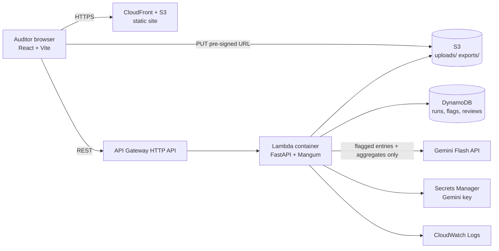

# JE Guard: automated journal entry testing

> **Synthetic data only.** Every ledger in this repo is generated by `data/generate_gl.py`. No real client data is used or should be uploaded.

An auditor uploads a general ledger CSV. JE Guard runs classic journal entry tests, adds an Isolation Forest anomaly score, combines everything into a transparent 0-100 risk score, asks Gemini to explain the 20 riskiest entries in plain English, and lets the auditor accept, dismiss or comment on each flag before exporting a findings report (PDF or CSV).

Built as a mid-level portfolio project for a data/backend role in Assurance: one FastAPI service, one DynamoDB table, one React app. No microservices, no multi-tenancy, no billing.

## Architecture



**Analysis flow:** `POST /runs` returns a pre-signed upload URL, the browser uploads the CSV straight to S3, `POST /runs/{id}/analyze` reads it, runs the tests, scores entries, calls Gemini once (top 20 + aggregate stats, never the whole ledger) and stores the run and flags.

## Repo layout

| Path | Contents |
|---|---|
| `backend/` | FastAPI app (`app/`), pytest suite (`tests/`), Lambda `Dockerfile` |
| `frontend/` | Vite + React + TypeScript + Tailwind, Vitest tests |
| `infra/` | AWS SAM template (`template.yaml`) |
| `data/` | `generate_gl.py` (synthetic ledger + injected anomalies), `evaluate.py` (precision/recall) |
| `docs/` | Screenshots folder and notes |

## Run locally (no AWS needed)

```bash
# 1. Backend  (Python 3.12)
cd backend
pip install -r requirements-dev.txt
export GEMINI_API_KEY=...        # optional: without it, template explanations are used
uvicorn app.main:app --reload    # http://localhost:8000  (docs at /docs)

# 2. Frontend (Node 20+)
cd frontend
cp .env.example .env
npm install && npm run dev       # http://localhost:5173
```

Click **Use sample dataset** on the first screen. Local mode stores runs under `backend/.local/`, and the upload endpoint stands in for the pre-signed S3 URL.

Generate a bigger ledger: `python data/generate_gl.py --rows 80000 --out data/synthetic_gl.csv`.

### Tests

```bash
cd backend && python -m pytest -q     # unit tests per audit test + API flow
cd frontend && npm test               # Vitest: chips, ring, steps, CSV validator
python data/evaluate.py               # precision/recall vs injected anomalies
ruff check .                          # Python lint
```

## Deploy to AWS (SAM)

```bash
cd infra
sam build && sam deploy --guided                       # builds the Lambda container image
aws secretsmanager put-secret-value --secret-id <GeminiSecret> --secret-string "<key>"
cd ../frontend
VITE_API_URL=<ApiUrl output> npm run build
aws s3 sync dist s3://<FrontendBucketName output> --delete
# then redeploy once with FrontendOrigin=<SiteUrl output> so CORS matches CloudFront
```

The AWS path follows the standard SAM resources but has not been deployed from this repo yet. Treat the template as a reviewed starting point. The Lambda uses a container image because pandas + scikit-learn exceed the zip size limit. Analysis runs synchronously inside the API Gateway 29-second limit, which is fine for 100k-row ledgers; a queue would be the next step for larger files.

## API

`POST /runs` · `POST /runs/{id}/analyze` · `GET /runs` · `GET /runs/{id}` · `GET /runs/{id}/flags` · `PATCH /flags/{id}` · `GET /runs/{id}/report?format=csv|pdf` · `GET /evaluation` (plus `PUT /runs/{id}/upload` in local mode and `GET /health`). Errors always return `{"error": {"message", "next_step"}}`.

## How scoring works

Each test that fires adds a configurable weight; the total is capped at 100 (Critical 80+, High 60+, Medium 40+, Low below). The ML layer is an Isolation Forest on amount, time, weekday, round/threshold indicators, self-approval and pair rarity. Its weight scales with how anomalous the entry is. The breakdown is shown for every flag.

| Test | Default weight |
|---|---|
| Self-approved | 30 |
| Duplicate (same amount, account, date) | 25 |
| Just below approval threshold (5% band) | 25 |
| Unusual account pairing (<0.5% of entries) | 20 |
| Round amount (multiple of 1,000) | 15 |
| Weekend / after-hours posting | 15 each |
| Benford's Law leading digit | 5 |
| Isolation Forest outlier | up to 20 |

## Evaluation results

`data/evaluate.py` generates 60,360 ledger lines (30,180 entries) with 1,530 injected anomalous entries, runs the pipeline and scores each test against the ground truth.

| Test | Precision | Recall | F1 | Caught / planted |
|---|---|---|---|---|
| Duplicate entry | 92% | 100% | 0.96 | 360 / 360 |
| Weekend posting | 100% | 100% | 1.00 | 240 / 240 |
| After-hours posting | 100% | 100% | 1.00 | 180 / 180 |
| Round amount | 73% | 100% | 0.84 | 240 / 240 |
| Just below threshold | 56% | 100% | 0.72 | 240 / 240 |
| Self-approved | 100% | 100% | 1.00 | 150 / 150 |
| Unusual account pairing | 100% | 100% | 1.00 | 120 / 120 |
| Statistical outlier (ML) | 64% | 25% | 0.36 | 389 / 1530 |
| Combined risk score >= 15 | 84% | 100% | 0.91 | 1530 / 1530 |

Rule-based vs Isolation Forest overlap: **573** entries flagged by both, **1249** rules only, **31** ML only (Jaccard 31%).

Reading these honestly: recall is high because the injected anomalies are textbook cases. Precision is lower for "round amount" and "just below threshold" because the generator also contains a few naturally round and naturally near-threshold entries, which is realistic. Isolation Forest has low recall on its own because it is unsupervised and capped at 2% contamination, which is why it complements rather than replaces the rules. Benford's Law is a ledger-level test, so it is shown as a chart rather than scored per entry. Numbers are for one seed; rerun to reproduce.

## Gemini usage and cost estimate

One request per run: the executive summary and the explanations for the top 20 entries, about 6-8k input tokens and 3-5k output tokens. At the Flash list prices configured in `backend/app/gemini.py` (USD 0.30 / 2.50 per million input / output tokens, editable via env vars) that is roughly **USD 0.01 or less per run**. Each run records actual token counts and an estimated cost, shown on the Dashboard. Output is requested as JSON, validated with Pydantic, and retried up to twice on invalid output. If no key is set or the call fails, deterministic template text is used and labelled as such. Prices change, so check the current Gemini pricing page.

## Design decisions: Nielsen's 10 heuristics

| # | Heuristic | Where it lives |
|---|---|---|
| 1 | Visibility of system status | Upload → Analyzing → Done step indicator, linear progress with live text, skeleton loaders, run status chips |
| 2 | Match with the real world | Auditor language throughout: journal entry, posting, approval threshold, self-approved; no developer jargon in the UI |
| 3 | User control and freedom | Undo snackbar after accept/dismiss, Reopen button, Cancel on upload, sheets close with Esc, router back works |
| 4 | Consistency and standards | One button system (filled / tonal / outlined / text), one chip style, same icon + label for each severity everywhere |
| 5 | Error prevention | CSV header check before upload, disabled actions until valid, confirm dialogs when replacing a file or resetting settings, numeric validation in Settings |
| 6 | Recognition over recall | Always-visible filters, labelled nav icons, persistent severity legend, saved filters as chips |
| 7 | Flexibility and efficiency | J/K next/previous, A accept, D dismiss, / focus search, saved filters, sortable columns |
| 8 | Aesthetic and minimalist design | One primary action per screen; Gemini scenario and procedure behind "Show" (progressive disclosure) |
| 9 | Help users recover from errors | Every API error carries a plain-language message plus a next step; Retry buttons; upload and download failures explain what to do |
| 10 | Help and documentation | First-run tip card, "How scoring works" drawer (live weights), tooltips on icon buttons, "How to read this" note on Insights |

**Design system.** Material 3 color roles, severity scale, elevation 0-3, type roles and easing curves are defined once in `frontend/tailwind.config.js` (colors resolve to CSS variables so light and dark share the same roles). Components use tokens only. One font family (Inter), three weights, tabular numerals. Navigation rail becomes a bottom bar below 768px, the table becomes stacked cards, the detail drawer becomes a full-screen bottom sheet. Severity is never color-only: every chip has an icon and a label. Motion is 150-300ms with Material easing, mostly transform and opacity (the risk ring animates stroke length and count-up animates text), and everything non-essential is disabled for `prefers-reduced-motion`.

## Screenshots

Add screenshots to `docs/screenshots/` after running locally (Upload, Dashboard, Flags with detail panel, Insights, Report, mobile at 360px). None are bundled.

## What I'd improve next

- Make analysis asynchronous (SQS + worker Lambda) with polling, so very large ledgers are not bound by the 29s API limit.
- Authentication (Cognito) so the review audit trail records real user identities instead of a placeholder header.
- Multi-line entries with debit/credit balancing checks and a proper chart-of-accounts mapping.
- Calibrate weights from labelled history (logistic regression) instead of hand-set defaults, and add SHAP-style explanations for the ML score.
- Playwright end-to-end tests and an accessibility audit pass with axe.
- Deploy the SAM stack in CI and add a smoke test.
